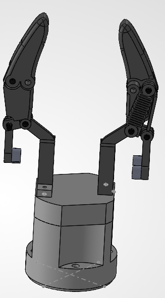

# Adaptive Two-Finger Gripper Design for Robotic Bin Picking

**Mechanical Design · SolidWorks · 3D Printing · Industrial Robotics · Mechatronics**

[English](./README.md) | [Français](./README.fr.md)

## Project Overview

This work was completed during my final year of engineering studies at **ESIGELEC** (2025–2026), as part of **PING 62 — Intelligent 3D Bin Picking for Collaborative Robots**, an academic team project.

The broader project investigated automated detection and grasping of objects using a Universal Robots manipulator and a perception system involving Python and ROS 2. **My personal contribution was the mechanical design of a two-finger adaptive gripper**, not the development of the computer vision or robot control software.

The proposed design aimed to accommodate objects with different geometries and provide compliant contact. It resulted in a SolidWorks model, an assembly drawing, a technical justification report, and a **3D-printed mechanical prototype**. The prototype was **not tested for actual grasping performance**.

## My Individual Contributions

I personally completed:

- Analysis of the gripping needs for objects of different shapes, including conical and hollow geometries.
- Review and comparison of gripping solutions: parallel jaws, adaptive two-finger mechanisms, three-finger grippers, and vacuum suction.
- Selection and justification of a two-finger adaptive gripper concept.
- Design and 3D modeling of the mechanical gripper in SolidWorks.
- Preparation of assembly views and a dimensioned technical drawing.
- Writing of the gripper concept and design justification report.

The rest of the bin-picking system was a **collective undertaking**. In particular, the vision models, object detection, grasp planning, and robot software described in the wider project documentation should not be attributed to me.

## Design Approach

### 1. Requirements and Concept Selection

The design objective was to explore a **compliant gripping solution** for parts with varied shapes in a bin-picking context. The concept study compared:

| Solution | Main trade-off considered |
| --- | --- |
| Parallel two-jaw gripper | Simple and repeatable, but less accommodating of irregular geometry |
| Adaptive two-finger gripper | Potential to conform to different shapes through mechanical compliance |
| Three-finger gripper | Multiple contact points, at the cost of added complexity and bulk |
| Vacuum gripper | Useful on suitable surfaces, but dependent on accessible area and sealing conditions |

An adaptive two-finger concept was selected as a promising approach for this application. **Its claimed benefits remained design objectives rather than experimentally demonstrated performance.**

### 2. Proposed Mechanical Concept

The design uses two articulated fingers, linked segments, mechanical joints, and a spring-based compliance concept. The report also considers actuation by servomotors, but the physical prototype did not include a complete motorized or electronically controlled system.

The detailed gripping forces, spring stiffness, and final mechanical behavior were **not calculated or experimentally validated**. The term *adaptive* refers here to the intended mechanical concept; it does not imply a validated, operational gripper.

### 3. SolidWorks Modeling

*SolidWorks view of the proposed adaptive two-finger gripper.*

I modeled the fingers, joints, linkages, and supporting structure in SolidWorks. The CAD work also included the layout of the proposed spring mechanism and a technical assembly drawing containing multiple views, sections, and dimensions.

### 4. 3D-Printed Prototype

A mechanical prototype of the proposed design was manufactured using **3D printing**. This materialized the CAD concept but did not constitute validation of the gripping mechanism. No functional grasping tests or motor/control-electronics integration were completed.

## Outcomes and Limitations

**Delivered:**

- Mechanical concept selection and written technical justification.
- SolidWorks 3D model and detailed assembly drawing.
- 3D-printed mechanical prototype.

**Not completed or validated:**

- Gripping-force calculation and spring stiffness sizing.
- Final material selection and mechanical verification.
- Integration of actuation and electronics.
- Experimental grasping tests on different parts.

This project is therefore a **mechanical design and prototyping study**, not a fully functional or validated robotic end-effector.

## Technical Documents

- [Gripper concept and design justification report](./Doc%20r%C3%A9capitulatif_justification%20choix%20Gripper%20adaptatif%20deux%20doigts.pdf) — already available in the repository.

The broader PING 62 technical report is used only to explain the team project's context; it is not published here as my individual work.

## Skills Demonstrated

Mechanical concept evaluation · SolidWorks 3D modeling · Assembly drawing · Technical justification · 3D prototyping · Working in a multidisciplinary robotics team

---

**ESIGELEC — Final-year academic team project (2025–2026)**  
**Individual scope: gripper design study, SolidWorks modeling, and technical justification.**
