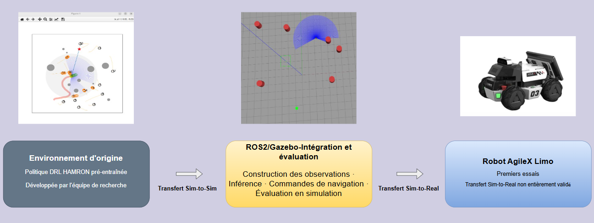

# Intégration et évaluation sous ROS 2 d'une politique DRL de navigation sociale — HAMRON

**Développement logiciel robotique | ROS 2 | Python | Gazebo | Apprentissage par renforcement profond | Navigation autonome**

[English](./README.md) | [Français](./README.fr.md)

**Inria — Équipe-projet CHROMA, Lyon | Mars–août 2026 | Stage R&D de six mois**

## Présentation du projet

Ce travail a été réalisé au sein de l'équipe-projet **CHROMA d'Inria**, dont les recherches portent notamment sur la perception, la prise de décision et la navigation autonome de robots mobiles évoluant dans des environnements partagés avec des humains.

Il s'inscrit dans la continuité des travaux sur **HAMRON (Human-Aware Multi-Robot Navigation)**, une méthode de navigation sociale fondée sur l'apprentissage par renforcement profond multi-agent.

La politique de navigation avait été préalablement développée et entraînée par l'équipe de recherche. Mon stage portait sur **son intégration dans un environnement robotique ROS 2/Gazebo, son évaluation en simulation et l'étude de son transfert vers un robot mobile réel**.

Le travail s'est organisé en deux phases principales : le développement d'une première chaîne d'inférence, puis sa consolidation, son extension, son évaluation expérimentale et de premiers essais matériels.

La figure suivante présente les principales étapes de cette démarche et situe les contributions réalisées au cours du stage.

*Figure — Vue d'ensemble du périmètre du stage : de l'environnement de simulation d'origine vers l'intégration ROS 2/Gazebo, puis les premiers essais sur robot AgileX LIMO. Les essais sur la plateforme réelle sont restés exploratoires et ne constituent pas une validation complète du transfert Sim-to-Real.*

## Objectifs techniques

L'objectif principal était d'étudier le transfert d'une politique DRL pré-entraînée depuis son environnement de simulation d'origine vers une architecture logicielle robotique fondée sur ROS 2.

Cette démarche visait notamment à :

- Développer une chaîne d'inférence ROS 2 pour une politique de navigation existante.
- Reconstruire les observations nécessaires à l'exécution du modèle.
- Générer des commandes de navigation à partir des actions produites.
- Intégrer et évaluer la chaîne sous Gazebo.
- Étudier progressivement les contraintes liées à son utilisation sur un robot réel.

Le travail concernait l'intégration et l'évaluation logicielle, et non la conception ou l'entraînement de la politique DRL.

## Mes contributions

### Phase 1 — Développement de la chaîne d'inférence ROS 2

La première phase a porté sur l'analyse de l'environnement logiciel existant et le développement d'une première chaîne d'inférence sous ROS 2/Gazebo.

Mes principales activités ont compris :

- L'analyse du fonctionnement général de la politique pré-entraînée et de sa procédure d'inférence.
- La conception d'une chaîne logicielle permettant son exécution sous ROS 2.
- L'implémentation du traitement des observations et des interfaces avec les données robotiques.
- L'intégration de l'inférence avec les commandes de déplacement du robot simulé.
- La réalisation des premières vérifications fonctionnelles dans Gazebo.

Cette phase a abouti à une chaîne d'inférence fonctionnelle dans un environnement de simulation volontairement simplifié.

### Phase 2 — Consolidation et évaluation expérimentale

La seconde phase s'est concentrée sur la fiabilisation de la chaîne logicielle et sur l'évaluation de son comportement dans des conditions de simulation progressivement plus complexes.

Mes travaux ont notamment porté sur :

- Le diagnostic et la correction d'incohérences dans la reconstruction des observations.
- L'extension progressive des informations traitées par la chaîne d'inférence.
- L'intégration et la vérification du système dans différents scénarios de simulation.
- La conception et l'automatisation de campagnes d'évaluation.
- L'analyse des comportements observés et des limites du transfert entre environnements.
- La réalisation de premiers essais fonctionnels sur un robot mobile AgileX LIMO.

Cette phase a mis l'accent sur le diagnostic méthodique, l'intégration incrémentale et la validation expérimentale.

## Architecture fonctionnelle

À un niveau conceptuel, la chaîne d'inférence ROS 2 repose sur quatre fonctions principales :

1. **Acquisition des données :** récupération des informations décrivant l'état du robot et son environnement.
2. **Traitement des observations :** préparation des données dans un format compatible avec la politique pré-entraînée.
3. **Inférence :** exécution du modèle DRL existant pour produire une action de navigation.
4. **Génération des commandes :** transmission de l'action au système de déplacement du robot simulé ou physique.

Cette organisation fonctionnelle permet de distinguer le travail d'intégration logicielle de l'architecture interne de la politique de recherche.

## Évaluation en simulation

L'évaluation sous Gazebo a constitué une partie importante du stage.

La démarche expérimentale reposait sur une progression entre des situations de navigation relativement simples et des environnements introduisant davantage de contraintes.

Le travail a notamment compris :

- La définition et l'exécution de scénarios de navigation reproductibles.
- L'automatisation des expérimentations et l'enregistrement de données d'évaluation.
- L'analyse des résultats de navigation et des caractéristiques des trajectoires.
- L'étude des écarts de comportement entre environnements de simulation.

Les principales métriques utilisées comprenaient :

| Métrique | Objectif |
|---|---|
| Taux de réussite | Proportion d'épisodes au cours desquels le robot atteint son objectif |
| Taux de collision | Proportion d'épisodes se terminant par une collision |
| Taux de timeout | Proportion d'épisodes dépassant la limite d'exécution |
| Longueur de trajectoire | Distance parcourue par le robot pendant la navigation |

Les configurations expérimentales détaillées, les résultats numériques et les conclusions scientifiques non publiées ne figurent pas dans cette documentation.

## Premiers essais sur AgileX LIMO

La dernière partie du stage a porté sur des essais exploratoires visant à réutiliser la chaîne d'inférence sur un robot physique AgileX LIMO. L'intégration a été abordée progressivement, sans chercher à valider d'emblée l'ensemble des capacités de la politique.

Dans un premier temps, les tests ont été effectués dans des conditions volontairement simplifiées : certaines composantes de l'observation, notamment les informations LiDAR et celles relatives aux interactions sociales, étaient neutralisées. La navigation reposait essentiellement sur l'état du robot et la position de l'objectif. Le comportement semblait globalement satisfaisant dans plusieurs essais simples, mais il n'était pas systématiquement fiable.

Des écarts de comportement ont amené à soupçonner une accumulation d'erreurs odométriques, sans qu'une mesure ou une caractérisation quantitative permette de confirmer cette hypothèse.

Une étape suivante a consisté à essayer de réintroduire les mesures du LiDAR réel. Cette intégration a rencontré des difficultés et n'a pas pu être finalisée ni validée dans le temps imparti.

Ces observations ne démontrent donc ni un fonctionnement robuste sur le robot réel, ni un transfert Sim-to-Real abouti. Aucune évaluation quantitative complète du transfert n'a été réalisée.

## Difficultés techniques et enseignements

Ce stage m'a confronté à plusieurs problématiques caractéristiques de l'intégration logicielle robotique :

- La compréhension et l'évolution d'une base logicielle de recherche existante.
- La cohérence des représentations de données entre différents environnements.
- Le diagnostic de comportements inattendus en simulation.
- L'intégration progressive de composants logiciels et de nouvelles sources d'observation.
- La construction et l'automatisation de protocoles d'évaluation reproductibles.
- La prise en compte des contraintes d'une plateforme robotique réelle.

L'un des principaux enseignements de cette expérience a été l'importance d'une **démarche de diagnostic et de validation progressive** : isoler les composants, limiter les facteurs modifiés simultanément et comparer les comportements observés aux résultats attendus.

## Périmètre et limites du travail

Le stage a permis de développer, consolider et évaluer en simulation une chaîne d'inférence ROS 2 pour une politique de navigation sociale DRL pré-entraînée.

Les limites suivantes doivent être précisées :

- La méthode HAMRON et la politique pré-entraînée ont été développées par l'équipe de recherche, et non dans le cadre de mon stage.
- Les évaluations structurées ont principalement été réalisées en simulation.
- Les essais sur robot réel sont restés préliminaires.
- L'intégration complète dans la pile de navigation Nav2 n'a pas été réalisée.
- La validation quantitative complète du transfert Sim-to-Real n'a pas été effectuée.

Ces éléments définissent le périmètre réel du travail et les perspectives de développement.

## Compétences mises en pratique

- Développement et intégration logicielle sous ROS 2.
- Programmation Python appliquée à la robotique.
- Intégration de modèles d'intelligence artificielle pré-entraînés.
- Simulation et expérimentation robotique sous Gazebo.
- Diagnostic logiciel et validation fonctionnelle.
- Conception de protocoles expérimentaux et automatisation de tests.
- Premiers travaux d'intégration sur robot mobile réel.
- Collaboration dans un environnement de recherche et développement appliquée.

## Référence scientifique

**Soualhi, T., Saraydaryan, J., & Matignon, L. (2026).**

*Deep Multi-Agent Reinforcement Learning for Multi-Robot Social Navigation in Constrained Environments.*

ICRA 2026 Workshop on Long-term Deployments in the Wild (LoWi).

[Consulter la publication scientifique HAMRON](https://mobile-robotics-hub.github.io/workshop2026/papers/LoWi2026_P04.pdf)

Cette publication présente le contexte scientifique de HAMRON et ne constitue pas une publication des résultats expérimentaux de mon stage.

---

**Note de diffusion :** cette page constitue une présentation générale de mes contributions d'ingénierie logicielle. Les rapports confidentiels, le code source du stage, les configurations détaillées, les figures expérimentales originales et les résultats de recherche non publiés ne sont pas inclus.
