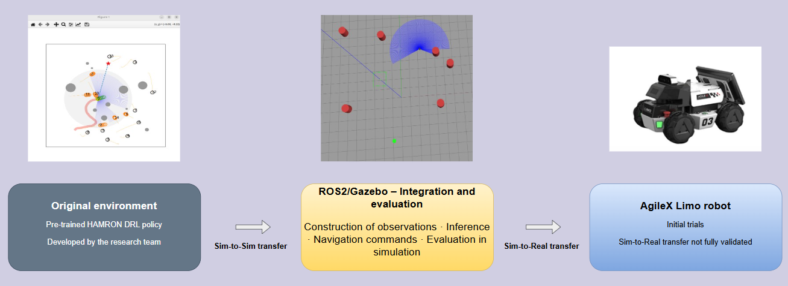

# ROS 2 Integration and Evaluation of a DRL Social Navigation Policy — HAMRON

**Robotics Software Development | ROS 2 | Python | Gazebo | Deep Reinforcement Learning | Autonomous Navigation**

[English](./README.md) | [Français](./README.fr.md)

**Inria — CHROMA Research Team, Lyon, France | March–August 2026 | Six-month R&D Internship**

## Project Overview

This project was carried out at **Inria**, within the CHROMA research team, which works on autonomous navigation, robotic perception, decision-making, and human-aware robotics.

The internship was related to **HAMRON (Human-Aware Multi-Robot Navigation)**, a deep multi-agent reinforcement learning approach developed by the research team for social navigation in constrained environments.

The research team had already developed and trained the navigation policy. My work focused on **integrating the pretrained policy into a ROS 2/Gazebo robotic simulation environment, evaluating its behavior, and investigating its transfer toward a physical mobile robot**.

The internship followed two main development phases: the initial implementation of a ROS 2 inference pipeline, followed by its consolidation, extension, experimental evaluation, and preliminary hardware deployment.

## Project Objectives

The main objective was to investigate how an existing DRL navigation policy could be transferred from its original simulation environment to a robotics software architecture based on ROS 2.

The work involved:

- Developing a ROS 2 inference pipeline for a pretrained navigation policy.
- Reconstructing compatible observations from robotic data.
- Generating navigation commands from the policy's outputs.
- Integrating and evaluating the system in Gazebo.
- Investigating the challenges of transferring the pipeline to a physical mobile robot.

The work concerned software integration and evaluation rather than the design or training of the DRL policy itself.

## My Contributions

### Phase 1 — ROS 2 Inference Pipeline Development

The first phase focused on understanding the existing research software and implementing the initial ROS 2/Gazebo inference pipeline.

My main activities included:

- Analyzing the existing navigation policy and its inference workflow.
- Designing the software pipeline required to execute the pretrained policy under ROS 2.
- Implementing observation processing and interfacing with robotic data sources.
- Integrating the policy inference process with robot navigation commands.
- Performing initial functional checks and tests in Gazebo.

This phase resulted in a functional inference pipeline operating in a deliberately simplified simulation setup.

### Phase 2 — Pipeline Consolidation and Experimental Evaluation

The second phase focused on improving the reliability of the software pipeline and evaluating its behavior in increasingly complex simulation conditions.

My work included:

- Diagnosing and correcting inconsistencies in observation reconstruction.
- Progressively extending the information processed by the inference pipeline.
- Testing the system across different simulation scenarios.
- Developing and automating experimental evaluation procedures.
- Analyzing observed behaviors and identifying limitations of the simulation transfer.
- Conducting preliminary functional tests using an AgileX LIMO mobile robot.

This phase emphasized systematic debugging, incremental integration, and experimental validation.

## Functional Architecture

At a conceptual level, the ROS 2 inference pipeline can be divided into four main functions:

1. **Data acquisition:** obtaining information about the robot and its environment.
2. **Observation processing:** preparing data in a format compatible with the pretrained policy.
3. **Policy inference:** executing the existing DRL model to generate a navigation action.
4. **Robot command generation:** forwarding the resulting action to the simulated or physical robotic platform.

This functional decomposition separates the software integration work from the internal architecture of the research policy.

## Simulation-Based Evaluation

Simulation testing was a central part of the internship.

The evaluation followed an incremental approach, starting with relatively simple navigation conditions and progressively introducing more challenging environments.

The experimental work involved:

- Defining and running reproducible navigation scenarios.
- Automating simulation experiments and recording evaluation data.
- Analyzing navigation outcomes and trajectory characteristics.
- Investigating behavioral differences between simulation environments.

The main evaluation metrics included:

| Metric | Purpose |
|---|---|
| Success rate | Proportion of episodes reaching the navigation goal |
| Collision rate | Proportion of episodes ending in collision |
| Timeout rate | Proportion of episodes exceeding the allowed execution limit |
| Trajectory length | Distance traveled during navigation |

The detailed experimental configurations, quantitative results, and unpublished research findings are not included in this documentation.

## Preliminary Experiments on AgileX LIMO

The final part of the internship involved exploratory experiments aimed at reusing the inference pipeline on a physical AgileX LIMO robot. Integration was approached incrementally rather than attempting to validate the policy's full capabilities from the outset.

Initial tests used a deliberately simplified observation setup: some inputs, including LiDAR data and information about social interactions, were disabled. Navigation relied mainly on the robot's state and the target position. Behavior appeared broadly satisfactory in several simple tests, but it was not consistently reliable. Some unexpected behavior led to a suspected accumulation of odometry errors; this remained a hypothesis, as it was not measured or quantitatively confirmed.

The next step attempted to reintroduce measurements from the physical LiDAR sensor. This integration encountered difficulties and could not be completed or validated within the available time. The physical-robot tests therefore remained partial and exploratory.

Scope of validation: these observations do not establish robust performance on the physical robot or a successful end-to-end Sim-to-Real transfer. No complete quantitative Sim-to-Real evaluation was conducted, and the policy's full social navigation capabilities were not validated on LIMO.

## Engineering Challenges and Lessons Learned

This internship involved several challenges commonly encountered when integrating research software into robotic systems:

- Understanding and extending an existing research codebase.
- Maintaining consistency between data representations across different environments.
- Diagnosing unexpected robot behaviors in simulation.
- Incrementally integrating software components and additional observation sources.
- Designing and automating reproducible evaluation procedures.
- Investigating the constraints associated with physical robot deployment.

An important lesson was the value of **incremental debugging and validation**: isolating individual components, changing a limited number of variables at a time, and comparing observed behaviors with expected outcomes.

## Scope and Limitations

The internship resulted in the development, consolidation, and simulation-based evaluation of a ROS 2 inference pipeline for a pretrained DRL social navigation policy.

The following boundaries are important:

- The HAMRON method and the pretrained navigation policy were developed by the research team, not during my internship.
- The main structured evaluation was performed in simulation.
- Physical robot experiments remained preliminary.
- Full integration into the Nav2 navigation stack was not completed.
- A complete quantitative Sim-to-Real validation was not performed.

These limitations define the actual scope of the work and identify possible directions for further development.

## Skills Applied

- ROS 2 software development and integration.
- Python programming for robotic applications.
- Integration of pretrained AI models into robotic systems.
- Gazebo simulation and experimentation.
- Software debugging and functional validation.
- Experimental protocol design and test automation.
- Preliminary integration on physical mobile robots.
- Collaborative work in an applied robotics research environment.

## Scientific Reference

**Soualhi, T., Saraydaryan, J., & Matignon, L. (2026).**

*Deep Multi-Agent Reinforcement Learning for Multi-Robot Social Navigation in Constrained Environments.*

ICRA 2026 Workshop on Long-term Deployments in the Wild (LoWi).

[Read the HAMRON research paper](https://mobile-robotics-hub.github.io/workshop2026/papers/LoWi2026_P04.pdf)

This publication provides scientific background on HAMRON and does not present the experimental results of my internship.

---

**Disclosure note:** This page is intended as a high-level overview of my software engineering contributions. Internship source code, confidential reports, detailed research configurations, original experimental figures, and unpublished research results are not included.
